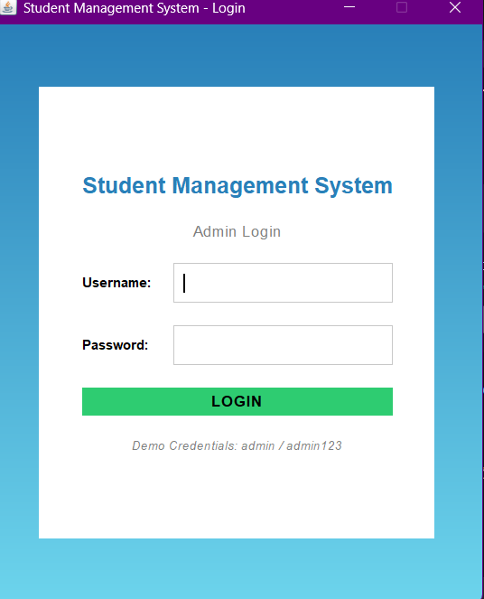
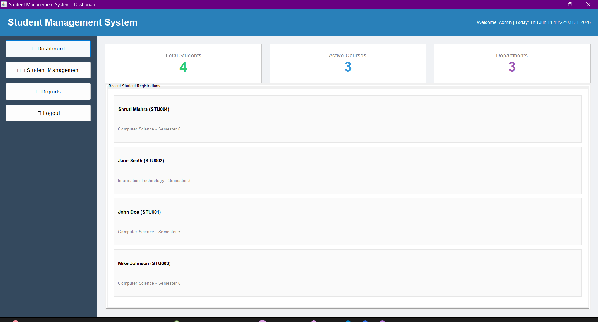
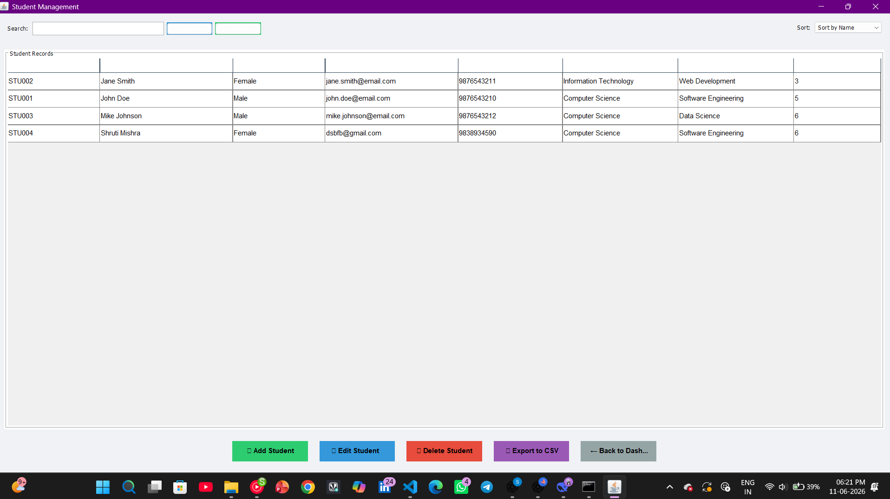
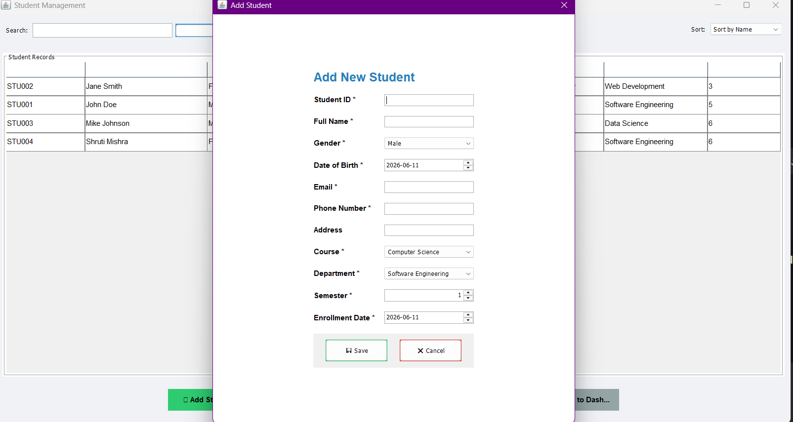

# Student Management System

A desktop Student Management System built using **Java Swing**, **JDBC (Java Database Connectivity)**, and **MySQL**. The application implements an **MVC + DAO + Service Layer** architecture designed for educational institutions to securely manage student enrollments, academic details, and administrative reports.

---

## Table of Contents

1. [Features](#features)
2. [Technology Stack](#technology-stack)
3. [Architecture and Design Patterns](#architecture-and-design-patterns)
4. [Project Structure](#project-structure)
5. [Prerequisites](#prerequisites)
6. [Database Setup](#database-setup)
7. [Database Configuration & Security](#database-configuration--security)
8. [Compilation & Execution (macOS)](#compilation--execution-macos)
9. [Default Login Credentials](#default-login-credentials)
10. [Application Screenshots](#application-screenshots)
11. [Design Highlights & Verification](#design-highlights--verification)

---

## Features

### 1. Authentication & Security
- **Secure Administrator Login** backed by MySQL database authentication.
- **SQL Injection Prevention**: Parameterized queries via `PreparedStatement` on all database operations.
- **Credential Protection**: Database passwords resolved dynamically without committing secrets to version control.
- Input validation on credentials with descriptive dialog feedback.

### 2. Dashboard & Analytics
- **Live Database Statistics**:
  - Total student enrollment count.
  - Active distinct courses count.
  - Active distinct departments count.
- **Recent Registrations**: Displays the 5 most recently enrolled students with name, ID, course, and semester.
- **Formatted Header**: Real-time localized date and time stamp.
- **Quick Navigation**: Sidebar with smooth hover feedback and distinct vector icons.

### 3. Student Record Management (CRUD)
- **Create (Add Student)**: Full registration form validating:
  - Unique Student ID (format: `STU001`, enforced duplicate check in MySQL).
  - Full Name (alphabetic validation).
  - Gender selection (Male, Female, Other).
  - Date of Birth & Enrollment Date via date pickers.
  - Email format verification (standard regex check).
  - Phone Number verification (10 digits starting with 6–9).
  - Course and Department dropdown selections.
  - Semester selection (enforced range 1–8).
  - Optional street address.
- **Read (View & Search)**:
  - Sortable tabular record display (`JTable`) with alternating row colors.
  - Real-time search by Student ID, student name, or email address.
  - Client-side sorting by Name, Course, or Department.
- **Update (Edit Student)**:
  - Loads existing student information into the modal form.
  - Student ID is preserved as the immutable primary key.
- **Delete Student**:
  - Record removal with explicit confirmation dialog.

### 4. Data Export & Reporting
- **CSV Data Export**: One-click export of the active student table records to a timestamped CSV file (`students_export_<timestamp>.csv`).
- **Administrative Text Report**: Summarizes total enrollments and details in a scrollable dialog.

---

## Technology Stack

| Component | Technology | Version | Purpose |
|---|---|---|---|
| Language | Java (JDK) | 11+ (Tested up to JDK 25) | Core application programming |
| GUI Framework | Java Swing / AWT | Standard Library | Desktop user interface |
| Persistence | JDBC (Java Database Connectivity) | Standard Library | Direct relational database communication |
| Database | MySQL Server | 8.0+ | Relational data store |
| Driver | MySQL Connector/J | 9.7.0 (bundled in `lib/`) | Official Type 4 JDBC driver |

---

## Architecture and Design Patterns

The project follows clean separation of concerns across standard architectural tiers:

```
[ View Layer ]        ui/ (LoginUI, DashboardUI, StudentManagementUI, AddEditStudentUI)
      │
      ▼
[ Service Layer ]     service/ (AuthService, StudentService, ValidationService)
      │
      ▼
[ Data Access Layer ] dao/ (AdminDAO, StudentDAO)
      │
      ▼
[ Database Layer ]    database/ (DatabaseConnection -> MySQL Server)
```

- **Model-View-Controller (MVC)**: Data model (`Student.java`) is separated from the Swing presentation layer (`ui/`) and SQL persistence layer (`dao/`).
- **Data Access Object (DAO) Pattern**: All raw SQL queries, `PreparedStatement` executions, and `ResultSet` extractions are encapsulated in `StudentDAO` and `AdminDAO`.
- **Service Layer Pattern**: Business validation (regex, range checks, duplicate prevention) and authentication logic are decoupled from UI event handlers.
- **Singleton Connection Pattern**: `DatabaseConnection` manages an active, reusable `Connection` with automatic reconnection if closed by the server.

---

## Project Structure

```
Student-Management-System/
├── .gitignore                          # Git exclusions (classes, local config, CSVs)
├── README.md                           # Project documentation
├── db.properties.example               # Template for local MySQL credentials
├── database/
│   └── schema.sql                      # Database creation, tables, views, and seed data
├── lib/
│   └── mysql-connector-j-9.7.0.jar     # Bundled MySQL JDBC driver
├── images/images/
│   ├── login.png                       # UI screenshot: Administrator Login
│   ├── dashboard.png                   # UI screenshot: Dashboard & Analytics
│   ├── students.png                    # UI screenshot: Student Records Table
│   └── add-student.png                 # UI screenshot: Add / Edit Student Dialog
└── src/
    ├── Main.java                       # Application entry point
    ├── TestDB.java                     # Standalone CLI JDBC connection test harness
    ├── database/
    │   └── DatabaseConnection.java     # Singleton JDBC connection manager
    ├── model/
    │   └── Student.java                # Student domain entity model
    ├── dao/
    │   ├── AdminDAO.java               # Admin authentication data access
    │   └── StudentDAO.java             # Student CRUD operations (JDBC PreparedStatements)
    ├── service/
    │   ├── AuthService.java            # Authentication service layer
    │   ├── StudentService.java         # Student business logic & validation wrapper
    │   └── ValidationService.java      # Static regex and boundary validators
    └── ui/
        ├── ButtonStyler.java           # Centralized button styling and hover feedback
        ├── LoginUI.java                # Administrator login frame
        ├── DashboardUI.java            # Main statistics and navigation dashboard
        ├── StudentManagementUI.java    # Table view with search, sort, and CRUD actions
        └── AddEditStudentUI.java       # Modal dialog for student registration/editing
```

---

## Prerequisites

Before running the project on macOS:
1. **Java JDK 11 or higher**:
   ```bash
   java -version
   javac -version
   ```
2. **MySQL Server 8.0 or higher** (running on port `3306`):
   ```bash
   mysql --version
   ```

---

## Database Setup

1. Start your local MySQL service.
2. Import the schema script using Terminal:
   ```bash
   mysql -u root -p < database/schema.sql
   ```
   *(Or open `database/schema.sql` in MySQL Workbench and execute).*
3. Verify that the database and tables were created:
   ```sql
   USE student_management_system;
   SHOW TABLES;
   SELECT * FROM admin;
   SELECT * FROM students;
   ```

---

## Database Configuration & Security

To prevent committing personal credentials to Git, `DatabaseConnection.java` resolves passwords dynamically in the following order:

1. **Environment Variable** (Recommended for Terminal / CI):
   ```bash
   export DB_PASSWORD=your_mysql_password
   ```
2. **JVM System Property**:
   ```bash
   java -Ddb.password=your_mysql_password ...
   ```
3. **Local Properties File** (`db.properties`):
   Copy the example template:
   ```bash
   cp db.properties.example db.properties
   ```
   Edit `db.properties` and add your password:
   ```properties
   db.password=your_mysql_password
   ```
   *(Note: `db.properties` is listed in `.gitignore` and is never tracked by version control).*

---

## Compilation & Execution (macOS)

Open Terminal and navigate to the project directory:

```bash
cd /path/to/Student-Management-System-main
```

### 1. Compile the Project

Create the output directory and compile all Java source files with the bundled JDBC driver:

```bash
mkdir -p bin

javac -cp "lib/mysql-connector-j-9.7.0.jar" -d bin \
  src/database/DatabaseConnection.java \
  src/model/Student.java \
  src/dao/AdminDAO.java \
  src/dao/StudentDAO.java \
  src/service/ValidationService.java \
  src/service/AuthService.java \
  src/service/StudentService.java \
  src/ui/ButtonStyler.java \
  src/ui/LoginUI.java \
  src/ui/DashboardUI.java \
  src/ui/AddEditStudentUI.java \
  src/ui/StudentManagementUI.java \
  src/Main.java \
  src/TestDB.java
```

### 2. Verify Database Connection (Optional CLI Check)

You can run the standalone CLI test harness before launching the GUI:

```bash
java -cp "bin:lib/mysql-connector-j-9.7.0.jar" TestDB
```

Expected output:
```
Database connected successfully!
✅ Connection successful!
✅ Found admin: admin
```

### 3. Run the GUI Application

```bash
java -cp "bin:lib/mysql-connector-j-9.7.0.jar" Main
```

---

## Default Login Credentials

| Attribute | Value |
|---|---|
| **Username** | `admin` |
| **Password** | `admin123` |

*(These credentials match the initial record seeded by `database/schema.sql`).*

---

## Application Screenshots

Visual gallery of the running Student Management System application:

### 1. Administrator Login Screen

*Secure authentication interface validating credentials against MySQL with real-time feedback.*

---

### 2. Dashboard & Analytics

*Executive dashboard displaying live database counts for total students, active courses, departments, and recent registrations.*

---

### 3. Student Records Management

*Interactive record view featuring alternating row colors, multi-field search, column sorting, and CRUD action controls.*

---

### 4. Add / Edit Student Dialog

*Modal form dialog with complete validation for personal information, contact formats, and academic enrollment.*

---

## Design Highlights & Verification

- **Strict JDBC Adherence**: Directly utilizes `java.sql.DriverManager`, `java.sql.Connection`, `java.sql.PreparedStatement`, `java.sql.Statement`, and `java.sql.ResultSet`.
- **Comprehensive Resource Management**: All `PreparedStatement`, `Statement`, and `ResultSet` instances in `StudentDAO` and `AdminDAO` are enclosed in `try-with-resources` blocks to eliminate database cursor and connection leaks.
- **Automatic Database Reconnection**: `DatabaseConnection.getConnection()` actively verifies if the cached connection is `null` or closed (`isClosed()`), automatically re-establishing connection with MySQL if dropped.
- **SQL Injection Immune**: All queries with user-supplied parameters strictly use typed `pstmt.setString(...)`, `pstmt.setDate(...)`, and `pstmt.setInt(...)` bindings.
- **Defensive Error Handling**: Catch blocks report structured `[DB ERROR]` and `[DAO ERROR]` diagnostics (including SQLState and ErrorCode) without leaking sensitive stack information to the user interface.
- **Layered Architecture**: `LoginUI` delegates to `AuthService` (which calls `AdminDAO`), and `StudentManagementUI` delegates to `StudentService` (which calls `StudentDAO`), enforcing a 3-tier structure.
